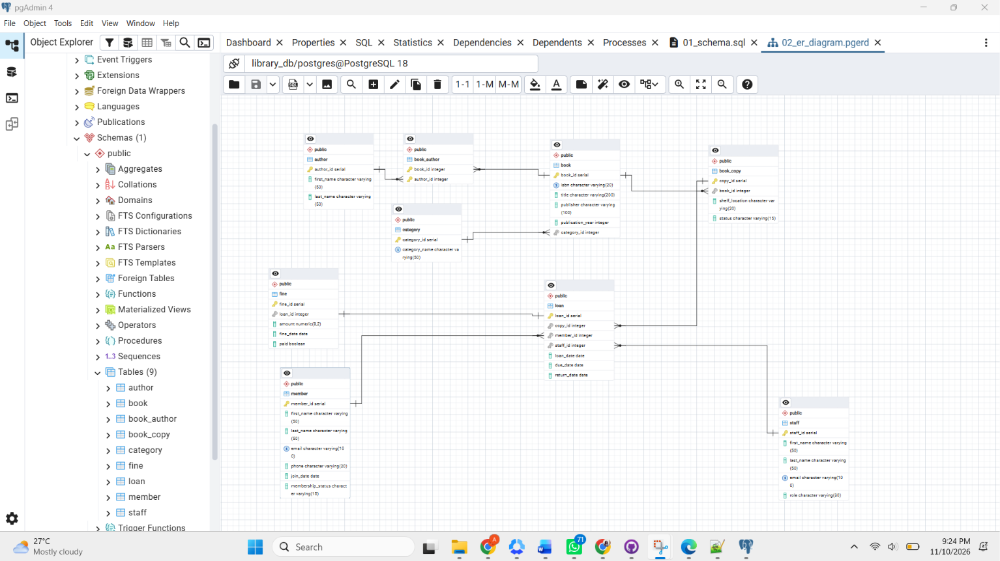
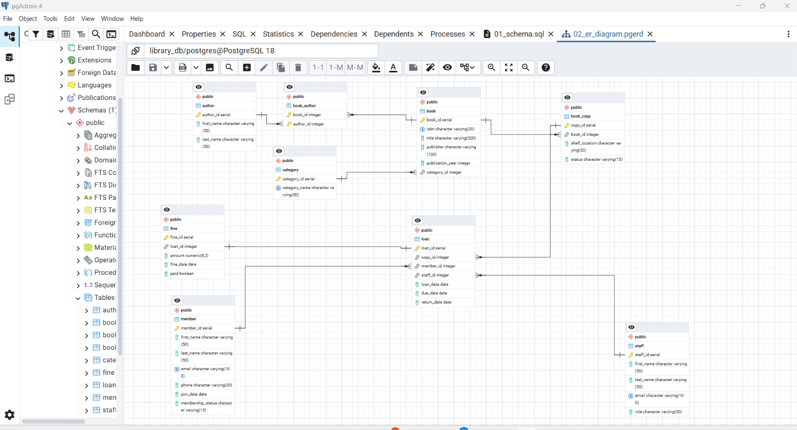

# Portfolio 1: Database Design and Modelling

## Case study
Rivers City Public Library Management System (simulated). See the main README for the full statement.

## Files
- 01_schema.sql : CREATE TABLE script for the 9 tables
- 02_er_diagram.png : ER diagram generated in pgAdmin
- 02_er_diagram.pgerd : the pgAdmin ER diagram file
- screenshots/ : evidence that the work ran

## Tables
category, author, book, book_author, book_copy, member, staff, loan, fine

## Keys
- Every table has a primary key (for example book_id, member_id).
- book_author uses a composite primary key (book_id, author_id).
- Foreign keys link the tables, for example loan.member_id references member.member_id.

## Constraints
- NOT NULL on required fields
- UNIQUE on isbn, member email, staff email, category name, and fine.loan_id
- CHECK on book copy status, membership status, publication year, fine amount, and loan dates

## Normalisation
- 1NF: every column holds a single value and every table has a primary key.
  Authors are not stored as a list inside book. They have their own table.
- 2NF: book_author has a composite key but no other columns, so nothing depends on part of the key only.
  Title details live in book, not in book_copy, so they are not repeated for each copy.
- 3NF: non-key columns depend only on the key. For example, category_name is stored once in category,
  not repeated in every book row.

## Design choices
- book (title) and book_copy (physical item) are separate tables so that copies of one title do not repeat its details.
- A loan points to a copy, because a specific physical item is borrowed.
- A fine is linked to a loan, with at most one fine per loan.

## Evidence

