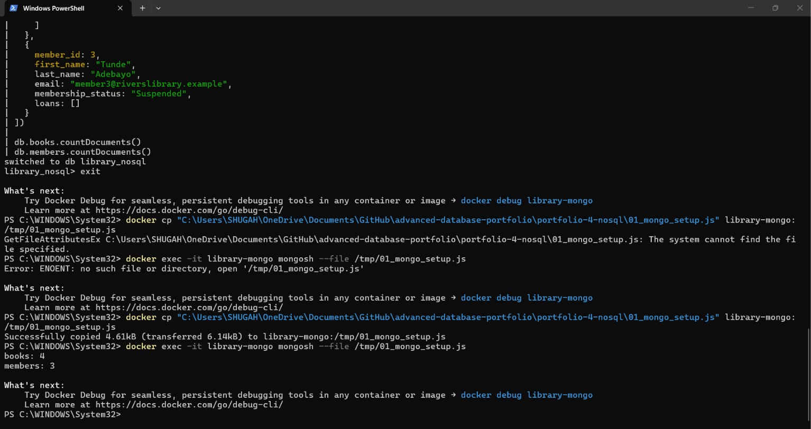
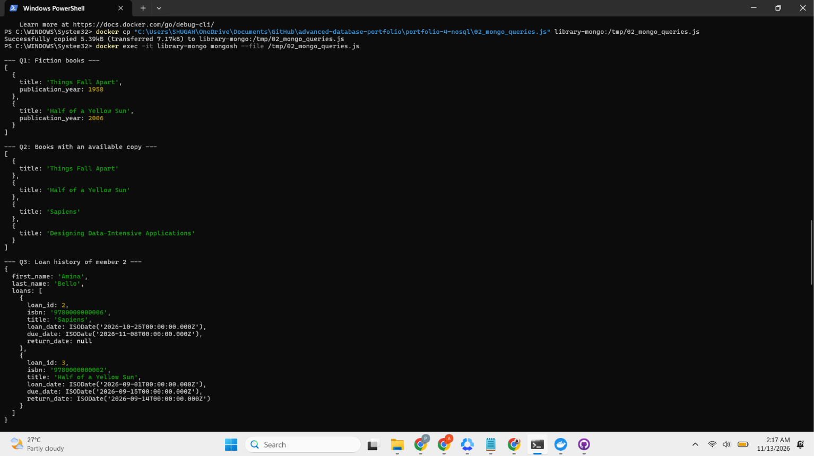
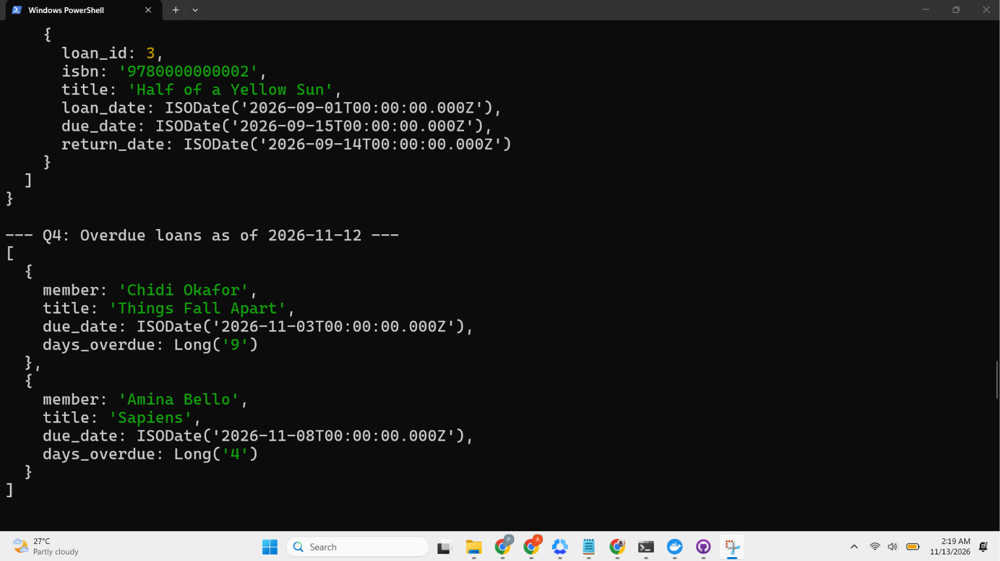
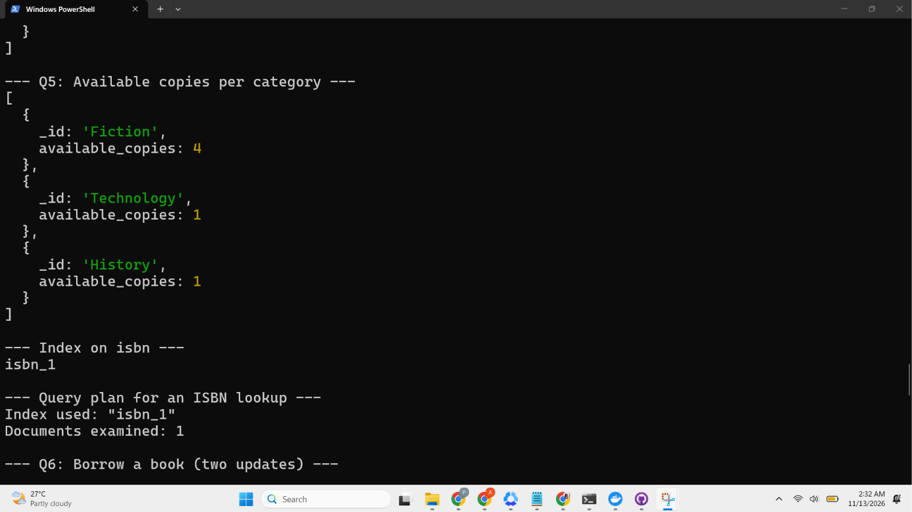
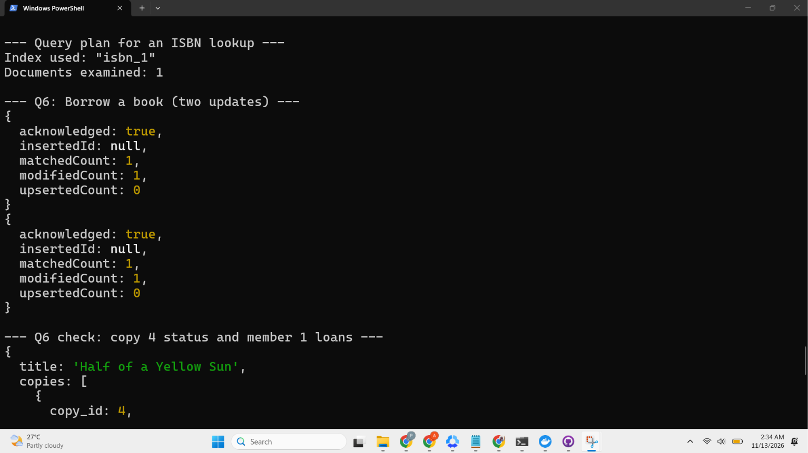
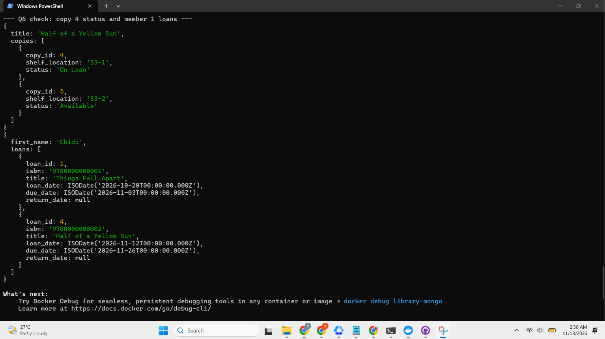

# Portfolio 4: NoSQL and Advanced Data Models

## Case study
Rivers City Public Library Management System (simulated). See the main README.

## Files
- 01_mongo_setup.js : creates the library_nosql database with books and members collections
- 02_mongo_queries.js : find, aggregation, index, query plan and update examples
- 03_query_output.txt : saved output of the query script
- screenshots/ : evidence of each step

## Database type
MongoDB (document database), run in a Docker container using the mongo:7 image and queried with mongosh.

## Data model
| Relational design (Portfolio 1) | MongoDB design |
|----|-------|
| book, author, book_author, book_copy | books collection, with authors and copies embedded in each book document |
| member, loan | members collection, with each member's loans embedded |
| category | a category field inside each book document |
| staff, fine | not modelled in this prototype |

## Queries tested
| Query | What it shows |
|----|-------|
| Q1 | Filter by category |
| Q2 | Filter inside an embedded array (books with an available copy) |
| Q3 | A member's full loan history in one read |
| Q4 | Aggregation pipeline for overdue loans ($unwind, $match, $project) |
| Q5 | Aggregation with grouping (available copies per category) |
| Index | Unique index on isbn; the plan used isbn_1 and examined 1 document |
| Q6 | Borrowing a book: two updates (copy status and the member's loans) |

## Why a document model suits this case study
- MongoDB's document model suits the library catalogue because related information can be stored together in one document. 
- For example, a book's title, authors, and available copies can be retrieved in a single read without joining multiple tables. 
- Similarly, a member's loan history can be accessed directly from their document. 
- The flexible structure also makes it easier to store different types of information, such as a download link for an e-book, without having to change a fixed table structure.

## Where it does not suit
- Although the document model offers flexibility, it also has some limitations in this case study. 
- Borrowing a book involves updating two separate documents: the book's copy status and the member's loan history. 
- While each individual document update is atomic, the two updates are not automatically treated as one transaction on a standalone MongoDB server. 
- Multi-document transactions require a replica set.

- Another limitation is data duplication. Since the book title is stored in each loan record, changing a title may require updating several records. 
- Also, embedding all a member's loans in one array could eventually make the document too large, especially as the library grows. 
- For a real-world system, storing loans in a separate collection would be more suitable. 
- Finally, complex reports involving all loan records may be easier to produce using SQL.

## Conclusion
MongoDB is useful for the library catalogue and retrieving member information, but it has limitations when handling transactions and reports involving multiple records. 
A hybrid approach could work better, using PostgreSQL for loans and fines that require strict transactions, and MongoDB for catalogue searches and member history retrieval.

## Limitations
The dataset is small (4 books, 3 members), so I make no performance claims. The index plan only
shows that the index is used.

## How to reproduce
1. Start MongoDB: docker run -d --name library-mongo -p 27017:27017 mongo:7
2. Copy the scripts in with docker cp, then run: docker exec -it library-mongo mongosh --file /tmp/01_mongo_setup.js
3. Run the same command with 02_mongo_queries.js.

## Evidence

