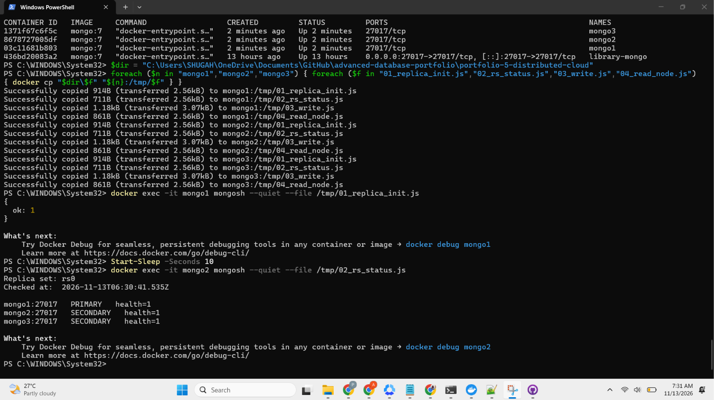
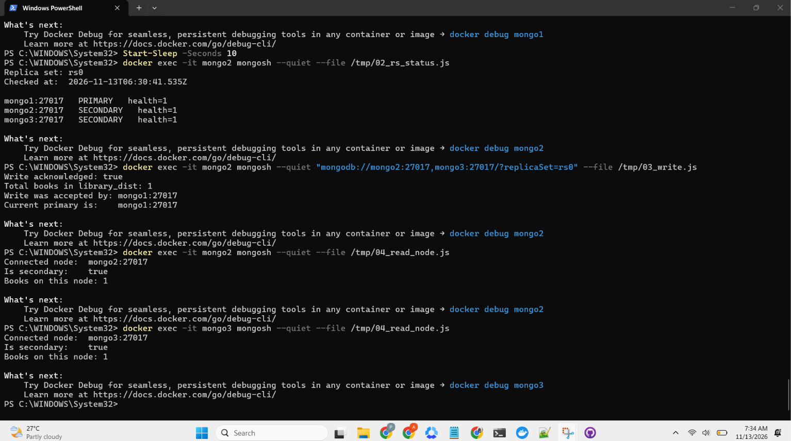
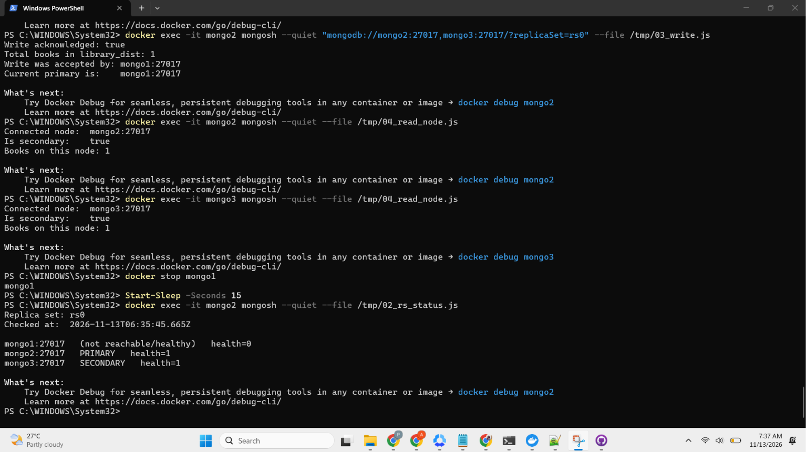
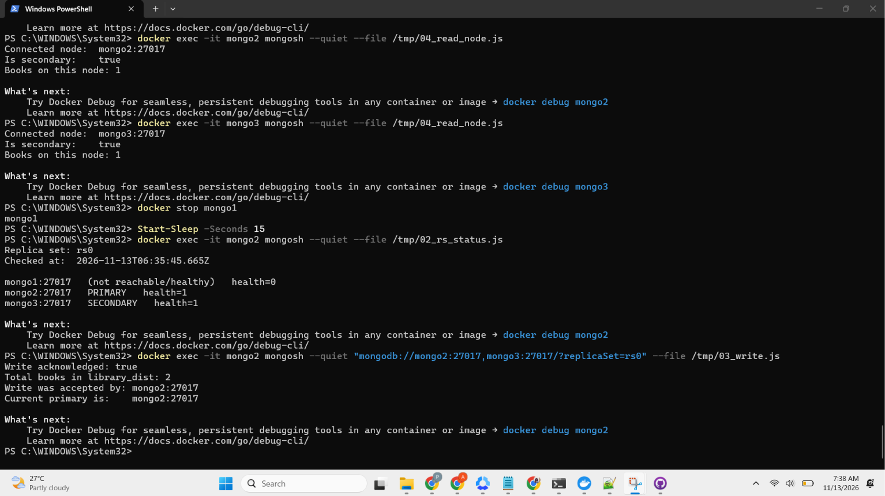
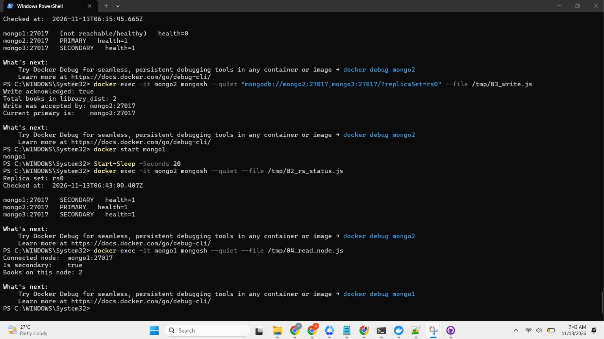

# Portfolio 5: Distributed and Cloud Database Exercise

## Case study
Rivers City Public Library Management System (simulated). See the main README.

## Files
- 01_replica_init.js : forms the replica set rs0 from three nodes
- 02_rs_status.js : prints each node's state
- 03_write.js : writes a catalogue record with majority write concern
- 04_read_node.js : reads from one specific node
- 05_demo_log.txt : full PowerShell log of the demo
- screenshots/ : evidence for each stage

## What I built
A three-node MongoDB replica set (mongo1, mongo2, mongo3, image mongo:7) running in Docker on one
Docker network. This is a local simulation of a distributed setup: the nodes share one physical
machine, so it shows replication and failover behaviour, not geographic distribution.

## Results
| Stage | What I did | Result | Evidence |
|---|---|---|---|
| 1 | Initialised the replica set | mongo1 PRIMARY, mongo2 and mongo3 SECONDARY | screenshots/01 |
| 2 | Wrote a catalogue record (majority write concern) | Acknowledged by mongo1, 1 book | screenshots/02 |
| 3 | Read directly from both secondaries | Each holds 1 book | screenshots/02 |
| 4 | Stopped the primary (mongo1) | mongo2 was elected PRIMARY, mongo1 not reachable | screenshots/03 |
| 5 | Wrote again with a node down | Acknowledged by mongo2, 2 books | screenshots/04 |
| 6 | Restarted mongo1 | Rejoined as SECONDARY and held 2 books, so it caught up | screenshots/05 |

## Observations
During the exercise, I noticed that when mongo1 went down, mongo2 automatically took over as the PRIMARY node. 
When mongo1 came back online, it rejoined as a SECONDARY instead of taking back its previous role. 
The library could still accept new records while one node was unavailable, which showed that the system could continue operating despite a node failure. 
I also observed that the record written during the downtime was automatically replicated to mongo1 after it rejoined.

## Replication, election and availability
Replication means keeping copies of the same data across multiple database servers. 
In this exercise, the three MongoDB nodes maintained copies of the library catalogue, so the data was not dependent on just one server. 
Having three nodes also made it possible to elect a new PRIMARY when the original one went down. 
Since two out of the three nodes form a majority, the remaining nodes could agree on a new PRIMARY and continue accepting writes. 
The majority write concern means MongoDB only confirms a write after it has been acknowledged by a majority of the replica set members. 
This helps reduce the risk of losing data if a node fails.

## Sharding design (discussed, not implemented)
Sharding is a way of distributing data across multiple database servers instead of keeping everything in one place. 
For the library system, I would consider using branch_id as the shard key because it would allow records belonging to different library branches to be distributed across servers. 
This could make it easier to manage a growing system with many branches. 
However, one possible problem is that a very busy branch could generate more requests than others, resulting in an uneven workload across the shards. 
For a small library with limited records and users, sharding would be unnecessary at this stage. 
A replica set would be sufficient for maintaining availability and protecting against individual node failures.

## Consistency and availability trade-offs
One thing to consider when using replica sets is that reading from a SECONDARY does not always guarantee that the latest update will be available immediately. 
This is because changes made on the PRIMARY may take a little time to reach the other nodes, meaning the data eventually becomes consistent. 
In my exercise, the secondaries matched the PRIMARY almost immediately because the dataset was very small and all three nodes were running on the same computer. 
I did not observe any stale reads during the demonstration. Reading from the PRIMARY is more suitable when the latest information is required, although it depends on the PRIMARY being available. 
For the library, reading from a secondary would be suitable for general catalogue searches, while recording a loan should use the PRIMARY to ensure that the transaction uses the most current data.

## Cloud deployment options
If the library system were to move beyond a local setup, one option would be to use MongoDB Atlas, a managed cloud database service that handles replica sets and much of the database administration. 
For the SQL side of the system, managed PostgreSQL services from providers such as AWS, Microsoft Azure or Google Cloud could also be considered. 
These services would reduce the amount of infrastructure the library needs to manage and provide features such as automated backups, failover and options for scaling as the system grows. 
The main disadvantages would be the ongoing cost of using cloud services and having less direct control over the underlying infrastructure compared to managing the database on its own servers.

## Link to Portfolio 4
In Portfolio 4 I noted that multi-document transactions in MongoDB need a replica set. This setup
provides that requirement, but I did not run a multi-document transaction here.

## Limitations
Everything ran on one computer, so there was no real network delay or geographic separation. The
dataset was two records.

## How to reproduce
1. Start three containers with: docker run -d --name mongoN --network library-net mongo:7 --replSet rs0 --bind_ip_all
2. Copy the scripts in with docker cp and run 01_replica_init.js on mongo1.
3. Run the other scripts as shown in 05_demo_log.txt.

## Evidence

